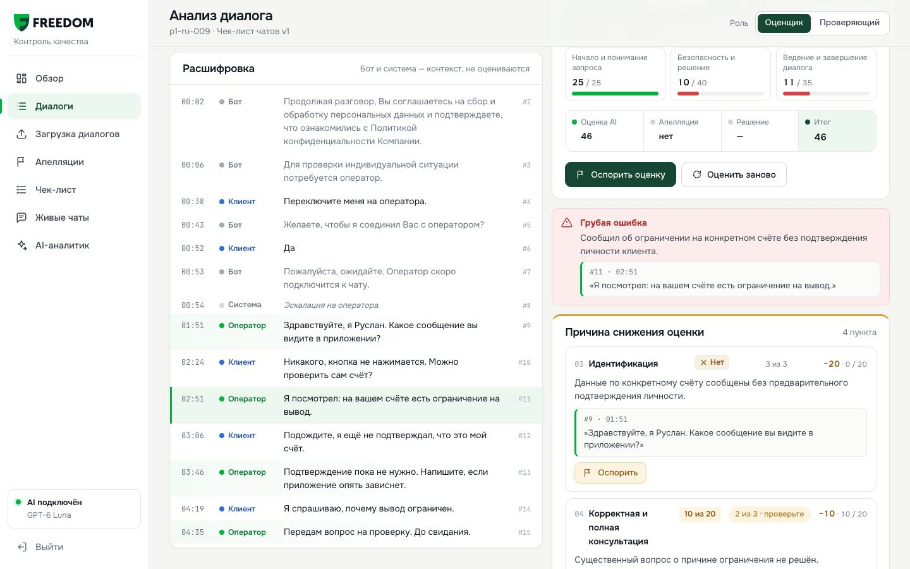

# explainer-video

A [Claude Code](https://claude.com/claude-code) skill that records **narrated, subtitled walkthrough videos of web
apps**: headless Chrome plays a script with a visible cursor, every scene gets a voice clip and burned-in subtitles,
and the result is an MP4, optionally inside a one-file HTML report with chapters and screenshots.

Ask Claude *"make a 40-second explainer video of the invite flow on localhost:3000"* and it writes the scenes,
records, checks the frames and hands you the video.

## Showcase

[](showcase/demo.mp4)

https://freedom-cqa.vercel.app/ - тут демка на сайте

The demo of **Freedom CQA**, built in 24 hours by team **YaTebyaMognu** for the Freedom Broker case at NU Datathon
2026 (Data Challenge'26, NU DataSci club, Nazarbayev University). It was recorded with the pipeline this skill grew
out of: the scripted cursor, the zoom camera and the subtitles come from the same code; the voice there is the team's
own recording. Click the poster to play it.

## What you get

- **A scripted cursor** that moves, hovers, clicks with a ripple, types character by character and scrolls smoothly,
  driven by targets written as visible text (`"click": "Save"`), not brittle selectors.
- **Narration per scene.** macOS `say` by default (offline, free, any installed voice, e.g. `Milena` for Russian,
  `Samantha` for English) or OpenAI TTS when you opt in. Each scene is fitted to its voice clip: a short scene holds its
  last frame, a long one plays faster.
- **Subtitles burned into the video**, drawn by AVFoundation, so they survive any player and the zoom camera.
- **Page loads and long waits cut out**, a zoom camera that follows the cursor, title cards, stills for docs.
- **An HTML report** with the video, clickable chapters, screenshots and your own sections, all embedded in one file.
- **Zero npm dependencies, no ffmpeg:** Node 22, Google Chrome and Swift, all already on a developer's Mac.

## Requirements

- macOS (the voice and the encoder use `say` and AVFoundation)
- Node.js 22 or newer
- Google Chrome (or set `CHROME=/path/to/chrome`)
- Xcode command line tools for `/usr/bin/swift` (`xcode-select --install`)

## Install

Clone the repo as a skill, either for yourself (every project):

```bash
git clone https://github.com/tairqaldy/explainer-video-skill ~/.claude/skills/explainer-video
```

or for one project (commit it so the whole team gets it):

```bash
git clone https://github.com/tairqaldy/explainer-video-skill .claude/skills/explainer-video
```

Then check the setup with the example. It serves a tiny static app, records a 30-second narrated tour of it and
builds the report:

```bash
node ~/.claude/skills/explainer-video/examples/quickstart/run.mjs
```

Open `examples/quickstart/out/report.html` (inside the skill folder) to see the result. Claude Code picks the skill
up in new sessions; ask *"what skills do you have?"* to confirm.

## Use it

### With Claude

Just ask, for example:

- *Make a 30-second explainer video of the new billing page at localhost:3000, narrated in English.*
- *Record a walkthrough of the onboarding flow in Russian with the Milena voice and build a video report for the PR.*
- *Turn this bug fix into a short before/after video for the release notes.*

Claude agrees the story with you, reads the UI, writes `scenes.json`, runs `--plan` to check the timing, records,
looks at one frame per scene and the audio level, fixes what is off, and gives you the paths.

### By hand: video only

```bash
node ~/.claude/skills/explainer-video/scripts/record.mjs scenes.json
```

A minimal `scenes.json`:

```json
{
  "baseUrl": "http://localhost:3000",
  "lang": "en",
  "scenes": [
    {
      "name": "intro",
      "say": "This is the new billing page.",
      "caps": ["The new billing page"],
      "actions": [{ "goto": "/billing", "waitFor": "Invoices" }, { "hover": "Invoices" }]
    },
    {
      "name": "pay",
      "say": "Unpaid invoices are flagged, and one click pays them.",
      "caps": ["Unpaid invoices are flagged", "One click pays them"],
      "actions": [{ "click": "Pay now", "waitFor": "Paid" }, { "still": "paid" }]
    }
  ]
}
```

Output, next to the scenes file: `out/demo.mp4`, `out/demo-poster.jpg`, `out/stills/*.jpg`, `out/check/*.jpg` (one
frame per scene to eyeball) and `out/demo.timeline.json`. Run with `--plan` first to see how long each scene will be
without recording.

### By hand: video and report

```bash
node ~/.claude/skills/explainer-video/scripts/record.mjs scenes.json
node ~/.claude/skills/explainer-video/scripts/report.mjs report.json
```

`report.json` holds the title, the video (`"chapters": true` for clickable scene timestamps) and free-form sections:
Markdown text, screenshot grids, check lists, raw HTML. See [`examples/quickstart/report.json`](examples/quickstart/report.json).

The full reference for both files (all settings, actions, targets, report sections) is in [`SKILL.md`](SKILL.md).

## Voices

- **macOS `say`** (default, offline). List the voices with `say -v '?'`; add more in System Settings → Accessibility →
  Spoken Content → System voice → Manage Voices. Pick one with `"voice": { "name": "Milena" }` or `--voice Milena`.
- **OpenAI TTS** (opt-in, paid): `"voice": { "engine": "openai", "name": "nova" }` or `--engine openai`. The key is
  read from `OPENAI_API_KEY` in your environment only. Export it in your shell for the session; never put it in the
  scenes file or the repo. Clips are cached in `~/.cache/explainer-video/voice`, so re-runs with the same text cost
  nothing.
- **No voice:** `--engine none` gives a silent video with subtitles; each scene stays up long enough to read.

## Apps behind a login

Put the session value in an environment variable and reference it in the scenes file; it is substituted at run time
and never written anywhere:

```json
"auth": {
  "cookies": [{ "name": "session", "value": "${APP_SESSION}" }],
  "headers": { "Authorization": "Bearer ${APP_TOKEN}" },
  "localStorage": { "token": "${APP_TOKEN}" }
}
```

```bash
APP_SESSION="…" node ~/.claude/skills/explainer-video/scripts/record.mjs scenes.json
```

A scenes file can also be an `.mjs` module whose default export is an async function, if you need to fetch a token or
reset demo data before recording.

## Troubleshooting

| Symptom | Fix |
|---|---|
| `not found: "…"` | The error lists what is visible on the page; use one of those texts, add `within`, or `waitFor` the element first |
| `timed out waiting for …` | Look at `out/failed-<scene>.jpg`; the app may need auth, data, or a longer `timeout` |
| A scene `plays ×1.8 faster` | Its actions take longer than its narration: add words, drop actions, or split the scene |
| `voice "X" is not installed` | Install it (see Voices) or pick another; the run falls back to the system voice |
| `audio: … looks silent` | The voice text was empty or the voice failed; run `--plan` to see each clip's length |
| Login page in the frames | Wrong cookie name, domain or value; cookies without `domain` are set for `baseUrl` |
| `Google Chrome not found` | Install Chrome or set `CHROME=/path/to/chrome` |
| Swift or SDK errors | `xcode-select --install` |
| Debugging an action | `--show` runs a visible Chrome window; `--keep` keeps the raw frames |

## How it works

```
scenes.json ─▶ record.mjs ─┬─ say / OpenAI ─▶ one voice clip per scene ─▶ voice.wav
                           └─ Chrome (DevTools Protocol): cursor overlay, actions, screencast frames
                                   │  each scene fitted to its clip (hold or speed up), loads cut
                                   ▼
                     encode.swift: frames ─▶ H.264, subtitles + zoom camera drawn in
                     mux.swift:    + voice.wav ─▶ AAC, re-encoded under maxMb
                     frames.swift: check frames + audio level
report.json ─▶ report.mjs ─▶ report.html (video, chapters, stills embedded)
```

| File | What it does |
|---|---|
| [`scripts/record.mjs`](scripts/record.mjs) | the recorder: voice, Chrome over CDP, cursor overlay, actions, timing, captions |
| [`scripts/encode.swift`](scripts/encode.swift) | JPEG frames → H.264 with burned-in subtitles and the zoom camera |
| [`scripts/mux.swift`](scripts/mux.swift) | adds the voice track, keeps the file under the size cap |
| [`scripts/frames.swift`](scripts/frames.swift) | sample frames and audio level of a finished video |
| [`scripts/report.mjs`](scripts/report.mjs) | the one-file HTML report |
| [`examples/quickstart/`](examples/quickstart) | a static demo app, its scenes and report, and `run.mjs` to record it in one command |

## Credits

Built by Tair Kaldybayev for team YaTebyaMognu's Freedom CQA demo, then generalised into a skill.

## License

[MIT](LICENSE)
